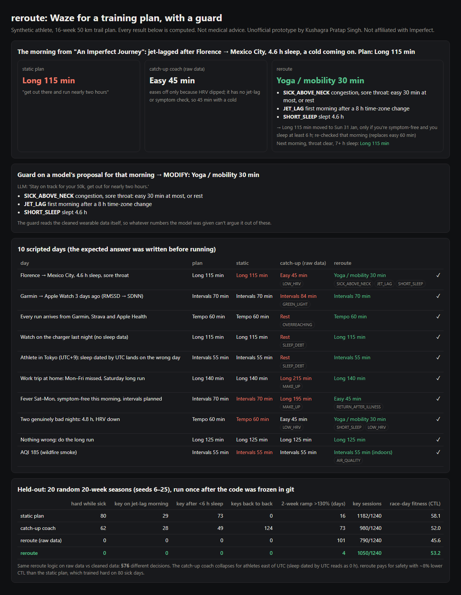

# reroute: Waze for a training plan, with a guard

In [An Imperfect Journey](https://imperfect.co/blog/welcome), Imperfect's founder describes a morning:
- jet-lagged after Florence → Mexico City, sleep-deprived and "coming down with a cold"
- his training app "told me to get out there and run nearly two hours"
- he wanted Waze, not MapQuest: "get some yoga for an active recovery day and knock out the two hour run the following morning"

Imperfect promises "Miss a day, get sick, or fall behind: we adjust so you still make it" ([imperfect.co](https://imperfect.co)). That promise has two quiet failure modes:

1. **Catching up the wrong way:** stacking the missed long run on top of the next one.
2. **Advice driven by bad wearable data:**
   - Apple Health stores HRV as **SDNN**, while Garmin reports **RMSSD**. SDNN is typically 30–50% higher, so a watch switch looks like a huge recovery ([Terra](https://tryterra.co/research/HRV-metric-discrepancy), [Apple docs](https://developer.apple.com/documentation/healthkit/hkquantitytypeidentifier/heartratevariabilitysdnn)).
   - One run arrives from Garmin, Strava *and* Apple Health.
   - A night on the charger reads as 0 h of sleep.
   - For anyone east of UTC, sleep dated by UTC lands on the wrong day.

`reroute` handles both, and it can sit around an LLM coach as a guard.



## What it does

| Part | What |
|---|---|
| `signals.clean` | One activity per real session (cross-source dedupe, HR-bearing source wins). HRV baseline **per metric**: it rebuilds for 7 nights after a device switch instead of mixing. Sleep dated by **local wake-up**, and the phone's time zone gives jet lag. Missing night = **unknown**. Artifact values dropped. `signals.naive` is the shortcut version, for comparison. |
| `guard.check` | OK / MODIFY / BLOCK for any proposed session, with reasons. **Neck check:** above the neck → easy ≤ 30 min; below → rest. Easy only for the first 2 symptom-free days after a fever. Jet lag (≥ 5 h shift) on the first morning. Sleep < 6 h. Low HRV only if last night **and** the 3-night average are low. 48 h between key sessions. 2-week load ≤ 130% of your recent level ([Nielsen et al. 2014](https://vbn.aau.dk/da/publications/excessive-progression-in-weekly-running-distance-and-risk-of-runn): >30% over 2 weeks). AQI > 150 → indoors. Two or more recovery flags → yoga / mobility. |
| `coach.Rerouter` | The guard decides today. A displaced key session is **swapped** into a later easy day, or replaces a less important key (long > tempo > intervals), keeping 48 h spacing and staying out of the race week. It's moved once at most, with "only if you're symptom-free and slept 6 h" re-checked that morning. Otherwise it's dropped. **Never stacked.** |
| `season` | A synthetic athlete lives a 20-week season (4 base + 16 build to a 50 km trail race): colds, fevers, trips across 5–10 time zones, busy days, bad nights, nights without the watch, a Garmin → Apple Watch switch, Strava and Apple Health duplicates, smoke days. Every coach sees the same nights. |

## Results (synthetic)

**The founder's morning** (scripted from the blog post): the plan says Long 115 min.
- **Static plan:** Long 115 min.
- **Catch-up coach:** Easy 45 min, only because HRV dipped. It has no jet-lag or symptom check.
- **reroute:** Yoga / mobility 30 min (SICK_ABOVE_NECK, JET_LAG 8 h, SHORT_SLEEP 4.6 h). The long run moves to Sunday, *only if symptom-free and slept ≥ 6 h*. Sunday is clear, so the long run happens.
- **The guard** turns an LLM-style "stay on track, run nearly two hours" into the same MODIFY.

**10 scripted days** (expected answer written before running): 10/10.
- The catch-up coach on raw data:
  - says "+20%, great recovery" after a watch switch
  - says "overreaching, rest" when one run arrives from three apps
  - says "sleep debt, rest" when the watch was on the charger, and every day for a Tokyo athlete
  - stacks 215 min after a missed week
  - plans 195 min the day after a fever
- reroute keeps the plan in the first four cases, refuses to stack, and goes easy after the fever.

**Held-out:** 20 random seasons (seeds 6–25), run once after the code was committed:

| | hard while sick | key on jet-lag morning | key after < 6 h sleep | keys back to back | 2-wk ramp >130% (days) | key sessions | race-day CTL |
|---|---|---|---|---|---|---|---|
| static plan | 80 | 29 | 73 | 0 | 16 | 1182/1240 | 58.1 |
| catch-up coach (raw data) | 62 | 28 | 49 | 124 | 73 | 980/1240 | 52.0 |
| reroute on raw data | 0 | 0 | 0 | 0 | 101 | 790/1240 | 45.6 |
| **reroute** | **0** | **0** | **0** | **0** | **4** | **1050/1240** | **53.2** |

- **Same logic, raw vs clean data:** 576 different decisions. Duplicated runs inflate the load history, so the ramp rule lets real spikes through (101 days vs 4).
- **The cost:** reroute gives up ~8% of race-day fitness (CTL) against the static plan, which trained hard on 80 sick days.
- **Ramp breaches:** dev seeds had 0, held-out had 4 days. Wearable heart-rate load and planned load differ slightly. I'm reporting it, not tuning it away.

## Run

```bash
pip install pytest              # everything else is the standard library
python demo.py                  # → out/report.html, out/report.json
python -m pytest -q             # 16 tests; python evaluate_seasons.py heldout re-runs the table
```

## Honest limits

- **Everything is synthetic**, including the athlete, events and wearable records. The 0s for sick-day and jet-lag sessions hold by construction: the guard has those rules, and the simulator scores the same rules from the truth. What the seasons do measure is the cost in fitness and key sessions, and how much bad data changes decisions.
- **CTL** (42-day load average) is a common fitness proxy, not a race-time prediction. The 130% ramp limit comes from a novice-runner cohort study and is a guide, not a law.
- **Rule thresholds** (6 h sleep, −1.5 SD HRV with a 3-night −1.0 SD, ≥ 5 h time-zone change) were tuned on dev seeds 1–5 only.
- **No real APIs:** no Garmin, Apple Health or Strava calls, no nutrition, no routes. The record shapes are simplified.
- **Not medical advice.** The neck check is a common sports-medicine rule of thumb.

Unofficial prototype by Kushagra Pratap Singh. Not affiliated with Imperfect.
